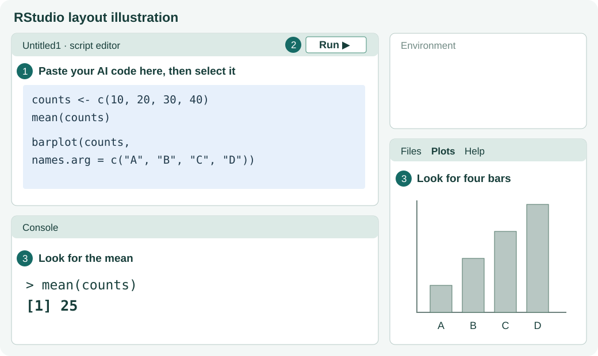
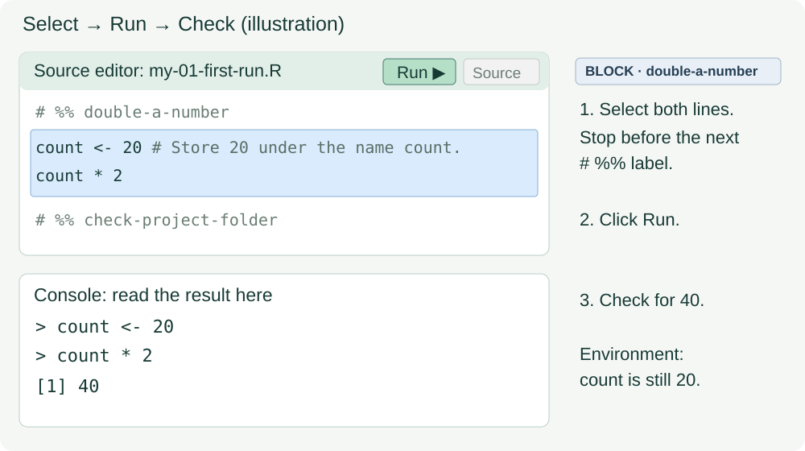

# 1. Your first successful run

**Your result:** a saved R script and a text file you can find again.

Follow the steps in order. Run the supplied code in your **my-** working copy.

(id-1-1-get-the-two-tools)=
Need R or RStudio Desktop? Follow the [installation instructions in Chapter 0](00-start-here.md#set-up-your-computer).

## 1.1 Download the student project

[Download the student ZIP](../downloads/start-from-zero-student.zip) and **extract it** into a folder you can find. On Windows, use **Extract All**.

## 1.2 Open the project and your working file

1. Open `start-from-zero.Rproj` from the extracted folder in RStudio. In **Files**, find `scripts` and `data`.
2. Choose **File → Open File**, open `scripts/01-first-run.R`, then choose **File → Save As**. In the project's **scripts folder**, use **my-01-first-run.R** as the filename. Confirm the editor tab now shows that name.



*Illustration; pane positions can vary. [Official pane guide](https://docs.posit.co/ide/user/ide/guide/ui/ui-panes.html).*

Your script appears in the **Source editor**. R's responses appear in **Console**. **Files** shows saved files; **Environment** lists objects currently in memory.

The word Source appears in several places:

| Where you see Source | What it means |
|---|---|
| Source editor in RStudio | The pane holding your script |
| Source button in RStudio | Execute the whole script; for this first lesson use **Run** on selected code |
| Source panel on the website | Expand code for reading; it does not execute R |
| `source("scripts/…")` in later code | Execute another saved R script as part of the workflow |

A line starting with `#` is a comment. Our `# %%` lines label code blocks, as explained in [Chapter 0](00-start-here.md#read-comments-and-find-a-code-block).

## 1.3 Run, then look

**Action 1 — Calculate.** Put the cursor on `1 + 1` and click **Run**, or press Ctrl + Enter on Windows / Cmd + Enter on macOS.

{span .script-block}`BLOCK · arithmetic`

{{r:arithmetic}}

**Look for:** `2` in the Console. If R prints `[1] 2`, `[1]` is an output index. Do not type `[1]` or the prompt `>` yourself.

**Action 2 — Give a value a name.** Run the {span .script-block}`BLOCK · store-sample-name` block. To run several lines, select the whole block and click Run.

{{r:store-sample-name}}

`<-` stores the value on the right under the name on the left. Quotes make `milk` text. The assignment normally prints nothing; the following `sample_name` line displays its stored value.

**Action 3 — Use a named number.** Predict the second line's result, then run {span .script-block}`BLOCK · double-a-number`.

{{r:double-a-number}}

In the Console, type `count` and press Enter. It still shows 20 because `count * 2` calculates a result without assigning it to `count`.



*Illustration using this lesson's code. Select both executable lines between the `# %% double-a-number` and `# %% check-project-folder` markers, then click Run. You may include comment lines in the selection. If a call spans several lines, include its final closing parenthesis. See screenshots in [Posit's Run and Source guide](https://docs.posit.co/ide/user/ide/guide/code/execution.html).*

**Stuck?** If the Console shows `+`, press Esc and run one complete line again. Other symptoms have a [short help route](00-start-here.md#get-unstuck).

## 1.4 Save a result and find it

First run {span .script-block}`BLOCK · check-project-folder` to check that R is working inside the project:

{{r:check-project-folder}}

R writes yes/no results as **TRUE/FALSE**. The folder's name may differ on your computer; the final result should be **TRUE**. If it is FALSE, reopen the `.Rproj` file.

Run {span .script-block}`BLOCK · save-first-result` to make an output folder and write a text file. Keep the supplied settings for this step:

{{r:save-first-result}}

In **Files → outputs → practice**, find `first-run.txt`. Read it back:

{span .script-block}`BLOCK · read-first-result`

{{r:read-first-result}}

**Save the script too:** use Ctrl/Cmd + S. Saving the `.R` file preserves your instructions. Running `writeLines()` creates the result file.

## 1.5 AI access

### Start with HKU GenAI

For HKU students, the recommended starting point is the **[HKU GenAI App](https://genai.hku.hk/)**. [HKU ITS's launch guide](https://its.hku.hk/news/introducing-hku-genai-app-the-new-home-for-hku-chatgpt-and-dall%C2%B7e/) confirms that it uses your HKU Portal login.

1. Open the app and sign in with your **HKU Portal account**.
2. Choose a text model from the app's current list, then start a new chat. ITS lists GPT, Gemini and DeepSeek among the available model families; the app shows the current choices.
3. Paste a short practice prompt, such as the one below. Keep RStudio open separately to run and check any returned code.

**Student allowance:** as checked on **7 November 2026**, ITS states **500,000 AI Credits per month**, replenished on the first day of each month and shared across the app and API Developer Portal. Credits are the platform's usage allowance, not a count of questions. Check the live [ITS quota page](https://its.hku.hk/services/ai-as-a-service/hku-genai/) for changes. This tutorial uses browser chat; no API setup or paid subscription is required.

The remaining balance appears at the top right of the app. The info icon gives current usage limits. See the ITS guides for [checking your balance](https://its.hku.hk/kb/how-do-i-see-how-many-ai-credits-i-have-left/) and [model limits](https://its.hku.hk/kb/how-can-i-view-current-usage-and-limits-of-ai-models/).

### Other browser chats available in Hong Kong

Choose one browser chat from the list if you prefer an alternative to HKU GenAI.

| Service | Open it | Access note and official information |
|---|---|---|
| Google Gemini | [gemini.google.com](https://gemini.google.com/) | Hong Kong is on Google's [supported web-app regions](https://support.google.com/gemini/answer/13575153?hl=en&mainArticle=true). Account eligibility and features can vary. |
| Microsoft Copilot | [copilot.com](https://copilot.com/) | Microsoft's [availability page](https://support.microsoft.com/en-au/microsoft-365-copilot/supported-languages-for-microsoft-365-copilot) includes Hong Kong. Sign-in and feature limits depend on the account. This is browser chat, not GitHub Copilot. |
| Poe | [poe.com](https://poe.com/) | Poe's [official FAQ](https://help.poe.com/hc/en-us/articles/19945140063636-Poe-Purchases-FAQs) lists Hong Kong. Free users have limited access; points and model availability vary. |

Availability was checked on **7 November 2026**. The provider links give current details. If account access or quota is an issue, try another service or use Chapter 3's code-inspection exercises.

### Optional AI exchange

You can continue at [Section 1.6](#id-1-6-restart-and-recreate) if you are studying without a chat account. [Chapter 3](03-working-with-ai.ipynb) provides a complete code-inspection route.

1. Start a new chat and send the prompt below.
2. Read the reply. If it contains code, copy only the R instructions, without triple backticks or prose.
3. At the end of your my- script, add `# My AI check`, paste or type the small check, save, select that block and Run.

```text
I am new to R. I ran count <- 20 and then count * 2.
Explain what count stores, what the second line prints, and how I can check
whether count changed. Use base R; do not add packages or an analysis pipeline.
```

**Check the explanation.** Enter `count` in the Console. It should still show 20. Send your actual code and output back if the reply disagrees.

## 1.6 Restart and recreate

Save your my- script. Choose **Session → Restart R**, then run its blocks from the beginning. The earlier objects disappear from Environment; your script and text file remain on disk. Rerunning recreates the objects and output.

| What you do | What changes |
|---|---|
| Edit and save the `.R` file | The instructions on disk change; old results do not automatically update. |
| Run the code | Objects and requested output files are created or updated. Save your edited script too. |
| Restart R | In-memory objects disappear. Saved scripts and output files remain. |

After the restart, run the script blocks again to recreate `count`; do not expect opening a script alone to execute it.

```{admonition} Ready to continue?
:class: tip
Find my-01-first-run.R and first-run.txt. Explain which contains instructions and which contains a result. Recreate the result after a restart.
```

**Try a change:** edit the message and output filename in your my- copy's `writeLines()` line. Run it and find both text files.

**Next:** [inspect a small table](02-minimum-r.ipynb).
