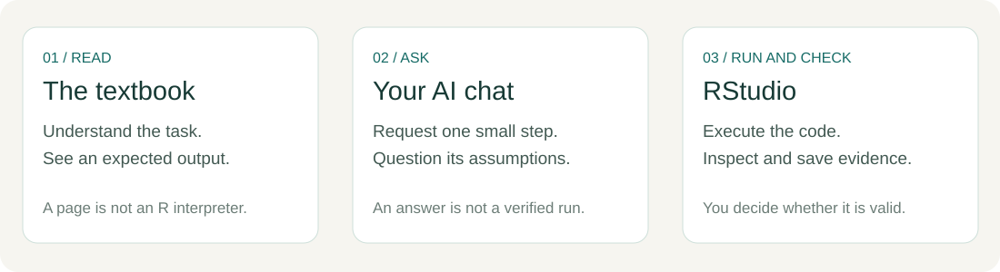

# 0. Start here

You will complete one small biological data task using R and AI assistance. The data have four invented milk samples. Three have recorded counts of **10, 20 and 30 CFU/mL**. The fourth count is missing.

Your question is simple. **How can you ask for the mean of the recorded counts and check that the code calculated the right thing?**

## Set up your computer

**1. Install R first.** R performs the calculations. Start at the official CRAN download page. [Download R](https://cran.r-project.org/)

- **Windows.** Choose **Download R for Windows**, open **base**, and run the installer.
- **macOS.** Choose **Download R for macOS** and select the installer for Apple silicon or Intel, matching your Mac's processor.

**2. Install RStudio Desktop.** RStudio gives you an editor and a Console for running R. Install and open the free Desktop application. [Official RStudio download guide](https://docs.posit.co/ide/user/download.html)

If you already have both tools, open RStudio. Next, download and extract the student project. [Chapter 1](01-first-run.ipynb#id-1-1-download-the-student-project)

## Where each part happens



| Place | What you do |
|---|---|
| This textbook | Read instructions and compare the expected output |
| RStudio | Edit your script, run R code and inspect results |
| AI chat, if used | Ask for a small piece of help and supply the data or error text it needs |

Chapter 1 explains how to access HKU GenAI and alternative browser chats. You can also use Chapter 3's supplied replies and complete the exercises through code inspection.

## Read comments and find a code block

In an R script, `#` starts a **comment** outside quoted text. R skips that note when it runs the code. For example:

```r
# %% double-a-number
count <- 20  # Store 20 under the name count.
count * 2
```

The first line labels a block. The next two lines store a number and calculate twice its value. A `#` inside quotes is text, such as `"sample #1"`.

When the book says to run {span .script-block}`BLOCK · double-a-number`, find `# %% double-a-number` in your script. Select the complete code below it, stopping before the next `# %%` label. Click **Run** in RStudio.

Closed **Source** and **Output** panels on this website show code and expected results when opened. Use RStudio to run the matching script block. Run a supplied block when the page instructs you to, even if its code panel stays folded.

## Keep a working copy

1. Extract the ZIP, then open `start-from-zero.Rproj` in RStudio.
2. Open the chapter script, such as `scripts/01-first-run.R`.
3. Choose **File → Save As** and save it as `my-01-first-run.R` inside the same `scripts` folder.
4. Run the named blocks in order, saving your edits with Ctrl/Cmd + S.

Chapters 1 and 2 practise these steps. In Chapter 3 you will compare a mean with a hand calculation. The supplied data are in `data/practice_counts.csv`. Results appear under `outputs/` when you run the scripts.

## Know the files you use

| Item | What it holds |
|---|---|
| `.R` script | Your saved instructions |
| `.csv` file | A table you can read into R |
| `.txt` file | A note or record you can open as text |
| Object in **Environment** | A named value in the current R session |

Restarting R clears the session's objects. Your saved files remain on disk. At the start of a chapter, reopen the project and run its blocks from the beginning.

## Get unstuck

Save your script and read the complete message in the Console.

| What you see | What to do |
|---|---|
| `object 'x' not found` | Run the earlier block that creates `x`. Check the spelling and capitals. |
| `cannot open file` | Open `start-from-zero.Rproj` from the extracted project, then retry the chapter. |
| The Console shows `+` | Press **Esc**, select the complete statement and run it again. |
| A mean returns `NA` | Inspect missing values with `is.na()`. Chapters 2 and 3 explain the recorded-count calculation. |
| A BLOCK label is missing | Open the matching reference script from the current student ZIP. |
| AI login or quota is an issue | Use a supplied code-inspection exercise. Chapter 1 lists alternative chats. |

For an AI repair request, copy three things as text.

```text
What I was trying to do:
The exact R code I ran:
The full message or unexpected output:
```

To start a chapter again, save your my- script, use **Session → Restart R**, and run the reference script from the top. Compare your changed block with the supplied one.

**Start.** [Run and save something for the first time](01-first-run.ipynb).
