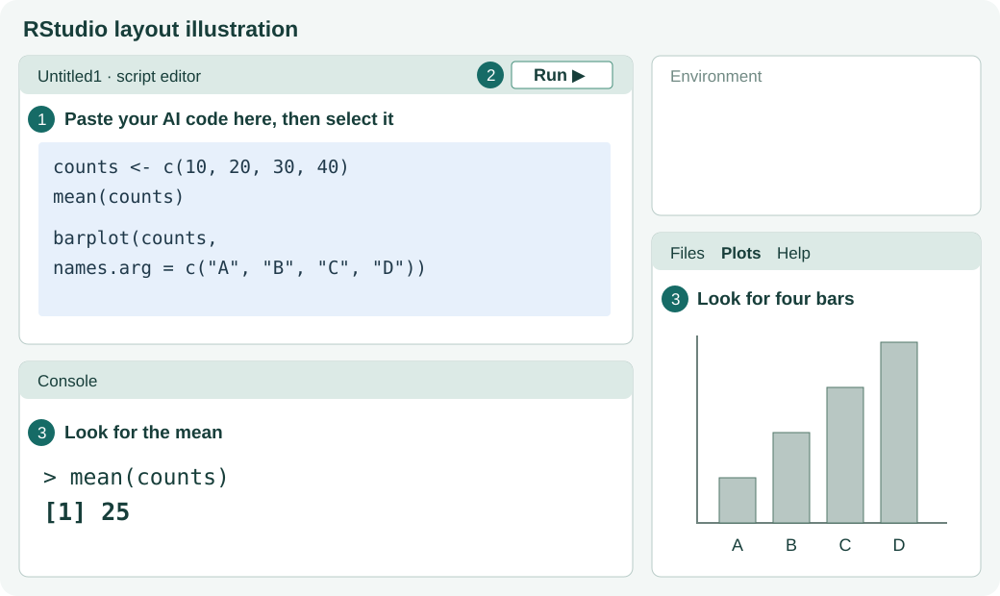

# 2. Copy, paste and run

## Paste into a new script

In **RStudio**, choose **File → New File → R Script**. A blank editor tab, usually called **Untitled1**, opens above the Console.

Click inside that blank editor and paste the R code you copied from AI.



*RStudio layout illustration. The numbered labels match the steps on this page.*

## Select the code and click Run

Click inside the script editor. Select all its code with **Ctrl + A** on Windows or **Cmd + A** on macOS. Click **Run** near the top of that editor.

You should see two results.

- In **Console**, a mean of **25**, often displayed as `[1] 25`.
- In **Plots**, four bars for samples **A, B, C and D**, with heights **10, 20, 30 and 40**.


Your AI may choose different colours or a different chart title.

````{admonition} If you need example code
:class: note dropdown

This example runs with the same prompt. You can copy the whole block into your empty script.

```r
counts <- c(10, 20, 30, 40)
mean(counts)

barplot(counts,
        names.arg = c("A", "B", "C", "D"),
        main = "Milk sample counts",
        ylab = "Count (CFU/mL)")
```
````

## If it does not run

If you see red error text, copy your code and the full error message back to the **same AI chat**. Send this request:

```text
I ran the code below in RStudio and got this error.
Please give me the corrected complete R code so I can copy and run it again.

My code:
[paste the code here]

Error:
[paste the full error message here]
```

Replace the code in your script with the complete corrected reply, select it and click **Run** again.

If the Console shows `+` and seems to wait, press **Esc**. Then check that you copied the complete code, including its closing brackets.

**Next.** [Ask for one change, then save your script](03-change-and-save.md).
